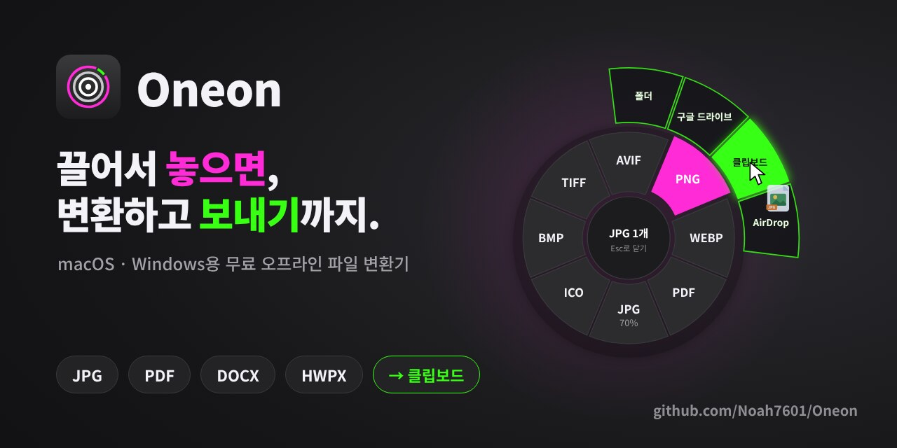
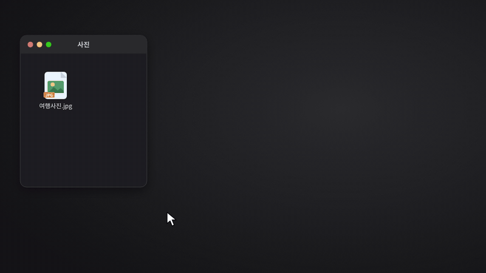

<p align="center">
  <a href="https://github.com/Noah7601/Oneon/releases/latest"></a>
</p>

<p align="center">
  <b>파일을 끌어서 원하는 형식에 놓으면 변환 끝. 바깥 네온 링에 놓으면 바로 보내기까지.</b><br>
  인터넷 없이 동작하는 macOS·Windows용 무료 파일 변환기예요.
</p>

<p align="center">
  <a href="https://github.com/Noah7601/Oneon/releases/latest"></a>
  <a href="https://github.com/Noah7601/Oneon/releases"></a>
  <a href="https://github.com/Noah7601/Oneon/actions/workflows/ci.yml"></a>
  
  
  <a href="LICENSE"></a>
</p>

<p align="center">
  <a href="https://github.com/Noah7601/Oneon/releases/latest"><b>다운로드</b></a> ·
  <a href="#설치">설치</a> ·
  <a href="#기능">기능</a> ·
  <a href="#지원-형식">지원 형식</a> ·
  <a href="#라이선스와-출처">라이선스</a>
</p>

<p align="center"><a href="README.md">English</a> · <b>한국어</b></p>

## 이렇게 동작해요

<p align="center">
  
</p>

1. 키를 누른 채 파일을 끌면 커서 위치에 **형식 도넛**이 열려요. 끌고 있는 파일에 맞는 형식만 보여요.
2. 원하는 형식에 놓으면 변환된 파일이 원본 옆에 생겨요.
3. 형식 조각 위에서 **잠깐 멈추면** 바깥에 초록 **네온 링**이 펼쳐져요. 여기에 놓으면 변환한 파일을 바로 보내요.

| | macOS | Windows |
|---|---|---|
| 변환 | <kbd>Shift</kbd> + 드래그 | <kbd>Ctrl</kbd> + 드래그 |
| 도구 (크기 조절, 합치기 등) | <kbd>Command</kbd> + 드래그 | <kbd>Alt</kbd> + 드래그 |
| AirDrop | <kbd>Command</kbd> + <kbd>Control</kbd> + 드래그 | – |

키는 설정 → 단축키에서 바꿀 수 있어요. 파일은 어디에도 업로드되지 않아요.

### 네온 링으로 보내기

| 보낼 곳 | 하는 일 |
|---|---|
| 📁 폴더 | 지정한 폴더에 복사 |
| ☁️ 구글 드라이브 | Google Drive 데스크톱 앱의 `내 드라이브/Oneon` 폴더에 복사 (폴더 이름은 바꿀 수 있어요) |
| 📋 클립보드 | 클립보드에 복사 |
| 📡 AirDrop | 시스템 AirDrop 창 열기 (macOS) |

- 파일은 항상 **복사**만 해요. 원본은 그대로 남아요.
- 보낼 곳 추가·순서·켜기/끄기, 보내기 전 확인 여부는 **설정 → 전송**에서 정해요.

## 설치

[릴리스](https://github.com/Noah7601/Oneon/releases/latest)에서 내려받으세요.

| 내 컴퓨터 | 파일 |
|---|---|
| Apple Silicon 맥 (M1 이상) | `Oneon-<version>-osx-arm64.dmg` |
| Intel 맥 | `Oneon-<version>-osx-x64.dmg` |
| Windows 10/11 (Intel/AMD) | `Oneon-<version>-win-Setup.exe` (또는 `win-Portable.zip`) |

**macOS 14 이상**

터미널에 아래 한 줄을 붙여넣으면 설치와 업데이트가 한 번에 끝나요.

```bash
curl -fsSL https://raw.githubusercontent.com/Noah7601/Oneon/main/installer/macos/update.sh | bash
```

내 Mac에 맞는 파일을 받아 SHA-256을 확인하고, 예전 앱은 휴지통으로 옮긴 뒤 설치해요. 마지막에 손쉬운 사용 설정이
열리면 Oneon을 다시 허용해 주세요. 1.11.7부터는 앱의 업데이트 버튼이 같은 일을 해요. 직접 설치하려면:

1. `.dmg`를 열고 Oneon을 응용 프로그램 폴더로 끌어다 놓으세요.
2. Apple 공증을 받지 않은 앱이라 처음 한 번은 실행이 막혀요. **완료**를 누른 뒤
   시스템 설정 → 개인정보 보호 및 보안에서 **그래도 열기**를 누르세요.
3. 드래그 단축키를 쓰려면 시스템 설정 → 개인정보 보호 및 보안 → **손쉬운 사용**에서 Oneon을 켜 주세요.

**Windows 10/11**
1. `Oneon-<version>-win-Setup.exe`를 실행하세요.
2. 코드 서명이 없어서 "Windows의 PC 보호" 창이 뜰 수 있어요. **추가 정보** → **실행**을 누르세요.
3. 설치할 때 우클릭 메뉴(Windows 11), 로그인 시 자동 실행, 추가 엔진을 고를 수 있어요.

Oneon은 이 저장소에서 업데이트를 확인하고, 업데이트해도 설정은 그대로 유지돼요. theOdrop에서 업데이트하면
설정·기록이 들어 있는 데이터 폴더를 처음 실행할 때 `Oneon`으로 자동으로 옮겨요.
모든 파일의 SHA-256 해시는 `Oneon-<version>-SHA256SUMS.txt`에 있어요.

## 기능

- **커서 위 형식 도넛**: 끌고 있는 파일에 맞는 형식만 보여줘요.
- **전송 네온 링**: 변환한 파일을 폴더·구글 드라이브·클립보드·AirDrop으로 바로 보내요.
- **다른 프로그램 없이 다양한 파일 변환**: 이미지, PDF, Word, Excel, PowerPoint, 한글(HWP), 전자책, 압축 파일,
  글꼴, CAD, 3D 모델. Office, 한컴오피스, LibreOffice가 없어도 돼요.
- **추가 엔진**: 동영상·음악(FFmpeg), LibreOffice, Pandoc, calibre, Ghostscript는 원할 때만 내려받아요.
  자세한 내용은 [ENGINES.md](docs/ENGINES.md)에 있어요.
- **여러 파일 한 번에 변환**: 품질, 크기, PDF 페이지, 저장 폴더, 파일 이름 프리셋을 지원해요.
- **감시 폴더**: 폴더에 들어오는 파일을 자동으로 변환해요.
- **다른 실행 방법**: 우클릭 메뉴(Finder 서비스, Windows 11 탐색기), 단축키, 드롭 영역, `oneon` 명령줄.
- 네온 핑크 기본 테마와 스포이드 강조색, 라이트·다크 테마, English·한국어·简体中文 지원.

## 지원 형식

| 원본 | 변환 대상 |
|---|---|
| **이미지**: JPG, PNG, WEBP, AVIF, TIFF, BMP, GIF, APNG, ICO, ICNS, JPEG XL, JPEG 2000, PSD/PSB, TGA, PPM, HEIC, QOI, DDS, PCX, MNG, CUR 등; GIMP XCF, 카메라 RAW(CR2, CR3, NEF, ARW, DNG 등), DICOM, OpenEXR, HDR은 읽기 | 위 형식끼리(HEIC⁵), PDF, SVG(벡터화), 크기 조정, 흑백 |
| **벡터**: SVG, SVGZ, EMF, WMF, AI · EPS, PS¹ · CDR, VSD, CGM, ODG, FODG² | PDF(벡터), PNG 등 이미지, SVG ↔ SVGZ, SVG → DXF/DWG, PDF → EPS/PS¹, SVG → EMF, WMF, ODG² |
| **PDF** | DOCX, HWPX, TXT, PNG, JPG, TIFF, CBZ, SVG²; 합치기, 나누기, 페이지 범위 |
| **문서**: DOCX, DOCM, DOTX, EML, Outlook MSG · DOC, ODT, FODT, OTT, RTF, WPS, WPD, Pages, ClarisWorks, MacWrite, T602 등² | PDF, DOCX, HWPX, EPUB, TXT, HTML; MSG → EML · ODT, FODT, OTT² |
| **스프레드시트**: XLSX, XLSM, XLS, XLT, ODS, CSV, TSV · OTS, FODS, Numbers, ET² | PDF, XLSX, ODS, CSV, TSV, JSON, HWPX, HTML · XLT, OTS² |
| **프레젠테이션**: PPTX, PPTM, POTX, PPSX · PPT, ODP, OTP, FODP, Keynote² | PDF, PNG, JPG, DOCX, HWPX · OTP² |
| **한글**: HWP, HWPX | PDF, PNG, DOCX, HWPX ↔ HWP, TXT, 마크다운, HTML |
| **텍스트**: TXT, 마크다운, HTML · reStructuredText, LaTeX, Org, AsciiDoc, Typst, MediaWiki, DocBook, Jupyter, Textile, man, OPML³ | PDF, DOCX, HWPX, EPUB · 서로 변환, PPTX 슬라이드³ |
| **전자책**: EPUB, KEPUB, MOBI, AZW3, AZW, AZW4, FB2, CBZ, CBR, CB7, HTMLZ, TXTZ · LIT, LRF, CHM, PDB 등⁴ | PDF, EPUB, KEPUB(코보), DOCX, TXT, HTML, HWPX · MOBI, AZW3⁴ |
| **동영상**⁵: MP4, MOV, MKV, WEBM, AVI, WMV, FLV, MPEG, TS, M2TS, 3GP, OGV, VOB 등 | MP4(H.264, HEVC, AV1), WEBM, MOV, MKV, AVI, GIF, APNG, MP3, M4A, 720p, 자막(SRT, ASS, WebVTT) |
| **오디오**⁵: MP3, M4A, AAC, WAV, FLAC, OGG, OPUS, WMA, AIFF, AMR, APE, WavPack, TTA, DSD(DSF, DFF), DTS, AC3, E-AC3 등 | MP3, M4A(AAC, ALAC), WAV, FLAC, OGG, OPUS, AAC, WavPack, TTA, W64, AC3, E-AC3 |
| **자막**: SRT, ASS/SSA, WebVTT, SAMI(SMI), LRC, TTML, MicroDVD, SCC | 서로 변환, UTF-8로 저장(CP949 한글 자막도 깨지지 않아요) |
| **압축 파일**: ZIP, 7Z, RAR, TAR, TAR.GZ, TAR.BZ2, TAR.XZ, GZ, ISO, CAB, DMG, ALZ, EGG 등 | 압축 풀기, ZIP, 7Z, TAR, TAR.GZ; 여러 파일 → ZIP 하나 |
| **CAD**: DWG, DXF | PDF, SVG, PNG, DWG ↔ DXF |
| **글꼴**: TTF, OTF, WOFF, WOFF2, EOT | 서로 변환 |
| **데이터**: JSON, JSON Lines, YAML, TOML, XML · vCard | 서로 변환, CSV·XLSX(표 모양 데이터); vCard ↔ CSV |
| **3D 모델**: GLB, glTF, STL, OBJ (+ MTL), 3MF, PLY | 서로 변환, PNG 미리보기 |

표시가 없는 형식은 오피스·한컴오피스·LibreOffice 없이 바로 변환돼요.
표시가 있는 형식은 추가 엔진이 필요하고, 필요할 때만 내려받아요: ¹ Ghostscript, ² LibreOffice, ³ Pandoc,
⁴ calibre, ⁵ FFmpeg ([자세히](docs/ENGINES.md)).

## 명령줄

`oneon` 명령은 앱과 같은 엔진과 프리셋을 써요. Windows는 설치할 때 고를 수 있고, macOS는 `.tar.gz` 안의
`install.sh`로 설치해요.

```
oneon convert photo.heic --to jpg
oneon convert *.png --to webp --quality 80 -o converted
oneon watch ~/Inbox --to pdf
```

모든 명령과 옵션은 `oneon help`에서 볼 수 있어요.

## 개인정보

파일은 내 컴퓨터에서 변환되고 업로드되지 않아요. 사용 데이터도 수집하지 않아요. 인터넷은 새 버전 확인
(설정 → 정보에서 끌 수 있어요), 내가 고른 엔진 다운로드, 링크를 눌렀을 때만 사용해요.
구글 드라이브로 보내기는 내 컴퓨터의 Google Drive 폴더에 파일을 복사할 뿐이고, 업로드는 Google Drive 앱이 해요.

## 직접 빌드하기

```bash
git clone https://github.com/Noah7601/Oneon.git
cd Oneon
dotnet run --project src/Filee.App   # .NET 10 SDK
dotnet test
```

[구조](docs/ARCHITECTURE.md) · [변환기 추가](docs/ADDING-A-CONVERTER.md) · [언어 추가](docs/ADDING-A-LANGUAGE.md)

README의 배너와 데모 GIF는 `docs/media/source/`의 HTML에서 만들었어요.

## 라이선스와 출처

MIT 라이선스. [LICENSE](LICENSE)를 참고하세요. 함께 들어 있는 외부 구성 요소는 각자의 라이선스를 따라요:
[THIRD-PARTY-NOTICES.md](THIRD-PARTY-NOTICES.md).

Oneon은 [Filee](https://github.com/KnifeLemon/Filee)(MIT, KnifeLemon)를 바탕으로 만들었어요.
변환 엔진과 형식 도넛은 Filee의 작업이에요. Filee가 마음에 드셨다면 원작자를 [후원](https://github.com/sponsors/KnifeLemon)해 주세요.
