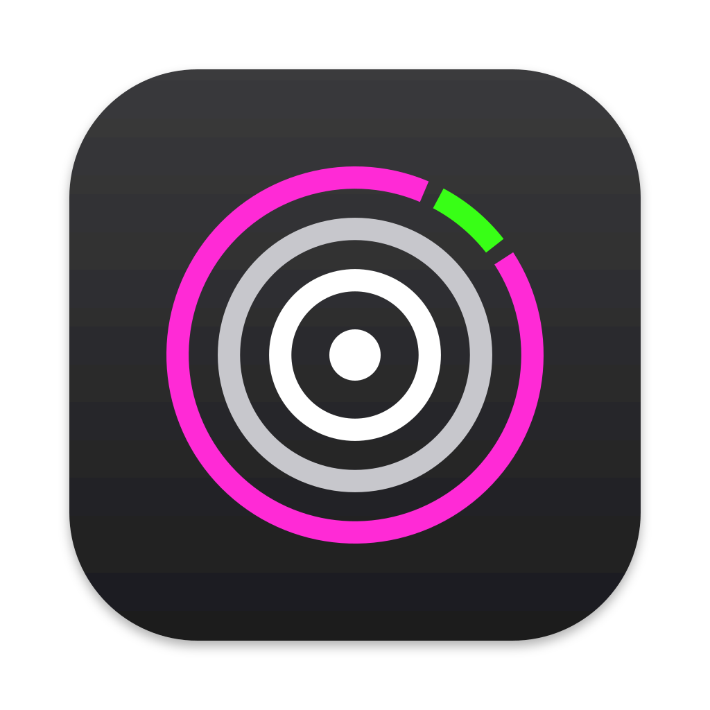

<p align="center">
  
</p>

<h1 align="center">theOdrop</h1>

<p align="center">
  <b>파일을 끌어서 원하는 형식에 놓으면 변환 끝.</b><br>
  인터넷 없이 동작하는 macOS·Windows용 무료 파일 변환기예요.
</p>

<p align="center">
  <a href="https://github.com/Noah7601/theodrop/releases/latest"><b>다운로드</b></a> ·
  <a href="#설치">설치</a> ·
  <a href="#기능">기능</a> ·
  <a href="#라이선스와-출처">라이선스</a>
</p>

<p align="center"><a href="README.md">English</a> · <b>한국어</b></p>

## 어떻게 쓰나요

키를 누른 채 파일을 끌면 커서 위치에 형식 링이 열려요. 끌고 있는 파일에 맞는 형식만 보여요.
원하는 형식 위에 놓으면 변환된 파일이 원본 옆에 생겨요. 파일은 어디에도 업로드되지 않아요.

| | macOS | Windows |
|---|---|---|
| 변환 | <kbd>Shift</kbd> + 드래그 | <kbd>Ctrl</kbd> + 드래그 |
| 도구 (크기 조절, 합치기 등) | <kbd>Command</kbd> + 드래그 | <kbd>Alt</kbd> + 드래그 |

키는 설정에서 바꿀 수 있어요.

## 설치

[릴리스](https://github.com/Noah7601/theodrop/releases/latest)에서 내려받으세요.

| 내 컴퓨터 | 파일 |
|---|---|
| Apple Silicon 맥 (M1 이상) | `theOdrop-<version>-osx-arm64.dmg` |
| Intel 맥 | `theOdrop-<version>-osx-x64.dmg` |
| Windows 10/11 (Intel/AMD) | `theOdrop-<version>-win-Setup.exe` (또는 `win-Portable.zip`) |

**macOS 14 이상**
1. `.dmg`를 열고 theOdrop을 응용 프로그램 폴더로 끌어다 놓으세요.
2. Apple 공증을 받지 않은 앱이라 처음 한 번은 실행이 막혀요. **완료**를 누른 뒤
   시스템 설정 → 개인정보 보호 및 보안에서 **그래도 열기**를 누르세요.

**Windows 10/11**
1. `theOdrop-<version>-win-Setup.exe`를 실행하세요.
2. 코드 서명이 없어서 "Windows의 PC 보호" 창이 뜰 수 있어요. **추가 정보** → **실행**을 누르세요.
3. 설치할 때 우클릭 메뉴(Windows 11), 로그인 시 자동 실행, 추가 엔진을 고를 수 있어요.

theOdrop은 이 저장소에서 업데이트를 확인하고, 업데이트해도 설정은 그대로 유지돼요.
모든 파일의 SHA-256 해시는 `theOdrop-<version>-SHA256SUMS.txt`에 있어요.

## 기능

- **커서 위 형식 링**: 끌고 있는 파일에 맞는 형식만 보여줘요.
- **다른 프로그램 없이 다양한 파일 변환**: 이미지, PDF, Word, Excel, PowerPoint, 한글(HWP), 전자책, 압축 파일,
  글꼴, CAD, 3D 모델. Office, 한컴오피스, LibreOffice가 없어도 돼요.
- **추가 엔진**: 동영상·음악(FFmpeg), LibreOffice, Pandoc, calibre, Ghostscript는 원할 때만 내려받아요.
  자세한 내용은 [ENGINES.md](docs/ENGINES.md)에 있어요.
- **여러 파일 한 번에 변환**: 품질, 크기, PDF 페이지, 저장 폴더, 파일 이름 프리셋을 지원해요.
- **감시 폴더**: 폴더에 들어오는 파일을 자동으로 변환해요.
- **다른 실행 방법**: 우클릭 메뉴(Finder 서비스, Windows 11 탐색기), 단축키, 드롭 영역, `theodrop` 명령줄
  (Windows는 설치할 때 선택, macOS는 `.tar.gz`의 `install.sh`로 설치).
- 라이트·다크 테마, English·한국어·简体中文 지원.

## 개인정보

파일은 내 컴퓨터에서 변환되고 업로드되지 않아요. 사용 데이터도 수집하지 않아요. 인터넷은 새 버전 확인
(설정 → 정보에서 끌 수 있어요), 내가 고른 엔진 다운로드, 링크를 눌렀을 때만 사용해요.

## 직접 빌드하기

```bash
git clone https://github.com/Noah7601/theodrop.git
cd theodrop
dotnet run --project src/Filee.App   # .NET 10 SDK
dotnet test
```

원본 프로젝트의 변경 사항을 계속 합칠 수 있도록 내부 프로젝트 이름은 `Filee`로 두었어요.
[구조](docs/ARCHITECTURE.md) · [변환기 추가](docs/ADDING-A-CONVERTER.md)

## 라이선스와 출처

theOdrop은 김명구(KnifeLemon)와 기여자들이 만든 [Filee](https://github.com/KnifeLemon/Filee)의 포크예요.
변환 엔진은 Filee의 것이고, theOdrop은 디자인, 아이콘, macOS·Windows 배포 방식을 따로 만들었어요.

MIT 라이선스, © 2026 Myeonggu Kim (KnifeLemon), Filee 기여자, theOdrop 기여자. [LICENSE](LICENSE)와
[NOTICE.md](NOTICE.md)를 참고하세요. 함께 들어 있는 외부 구성 요소는 각자의 라이선스를 따라요:
[THIRD-PARTY-NOTICES.md](THIRD-PARTY-NOTICES.md).
