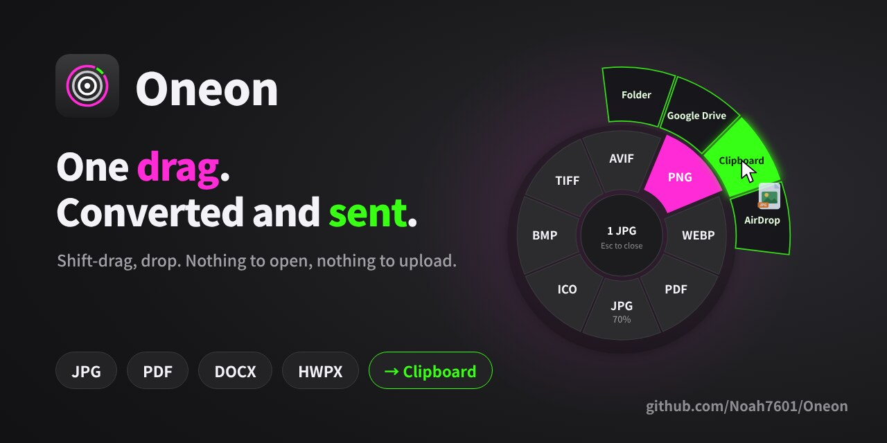
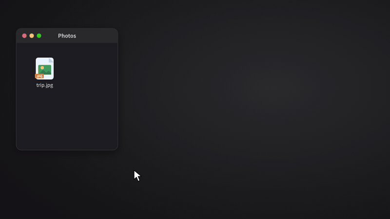

<p align="center">
  <a href="https://github.com/Noah7601/Oneon/releases/latest"></a>
</p>

<p align="center">
  <b>One drag. Converted and sent.</b><br>
  Shift-drag a file, drop it on a format — or on the neon ring to send it. Nothing to open, nothing to upload.<br>
  A free, offline file converter for macOS and Windows.
</p>

<p align="center">
  <a href="https://github.com/Noah7601/Oneon/releases/latest"></a>
  <a href="https://github.com/Noah7601/Oneon/releases"></a>
  <a href="https://github.com/Noah7601/Oneon/actions/workflows/ci.yml"></a>
  
  
  <a href="LICENSE"></a>
</p>

<p align="center">
  <a href="https://github.com/Noah7601/Oneon/releases/latest"><b>Download</b></a> ·
  <a href="#install">Install</a> ·
  <a href="#features">Features</a> ·
  <a href="#supported-formats">Formats</a> ·
  <a href="#license-and-credits">License</a>
</p>

<p align="center"><b>English</b> · <a href="README.ko.md">한국어</a></p>

## How it works

<p align="center">
  
</p>

1. Hold a key while you drag files. A **format donut** opens at the cursor, showing only the formats that fit.
2. Drop on a format and the converted file appears next to the original.
3. **Pause** on any slice and a green **neon ring** fans out around it. Drop there to convert and send in one go.
   The first slice, **Original**, sends the files as they are, without converting.

| | macOS | Windows |
|---|---|---|
| Convert | <kbd>Shift</kbd> + drag | <kbd>Ctrl</kbd> + drag |
| Tools (resize, merge, …) | <kbd>Command</kbd> + drag | <kbd>Alt</kbd> + drag |

You can change the keys in Settings → Shortcuts. Nothing is uploaded.

### Sending with the neon ring

| Send to | What happens |
|---|---|
| 📁 Folder | Copied into a folder you pick |
| ☁️ Google Drive | Copied into `My Drive/Oneon` of the Google Drive desktop app (you can rename the folder) |
| 📋 Clipboard | Copied to the clipboard |
| 📡 AirDrop | Opens the system AirDrop sheet (macOS) |

- Files are always **copied**. The original stays where it is.
- Add, reorder or switch off places, and choose whether Oneon asks first, in **Settings → Transfer**.

## Install

Download from [Releases](https://github.com/Noah7601/Oneon/releases/latest).

| Your computer | File |
|---|---|
| Mac with Apple Silicon (M1 or later) | `Oneon-<version>-osx-arm64.dmg` |
| Mac with Intel | `Oneon-<version>-osx-x64.dmg` |
| Windows 10/11 (Intel/AMD) | `Oneon-<version>-win-Setup.exe` (or `win-Portable.zip`) |

**macOS 14 or later**

Install or update in one step (paste into Terminal):

```bash
curl -fsSL https://raw.githubusercontent.com/Noah7601/Oneon/main/installer/macos/update.sh | bash
```

It picks the build for your Mac, checks its SHA-256, replaces the old app (into the Trash) and opens the Accessibility
settings so you can allow Oneon again. From 1.11.7 on, the Update button in the app does the same. Or by hand:

1. Open the `.dmg` and drag Oneon into Applications.
2. Oneon is not notarized by Apple, so the first start is blocked once. Click **Done**, then go to
   System Settings → Privacy & Security and click **Open Anyway**.
3. For the drag shortcuts, switch Oneon on under System Settings → Privacy & Security → **Accessibility**.

**Windows 10/11**
1. Run `Oneon-<version>-win-Setup.exe`.
2. It is not code-signed, so "Windows protected your PC" may appear. Click **More info** → **Run anyway**.
3. Setup can add the right-click menu (Windows 11), start at sign-in and optional engines.

Oneon checks this repository for updates and keeps your settings when it updates. Coming from theOdrop, the first
start moves your settings and history into the new `Oneon` data folder.
Every file's SHA-256 hash is in `Oneon-<version>-SHA256SUMS.txt`.

## Features

- **Format donut at the cursor**: only the formats that make sense for the files you drag.
- **Neon transfer ring**: send the result, or the original as it is, to a folder, Google Drive, the clipboard or AirDrop.
- **Many file types without other software**: images, PDF, Word, Excel, PowerPoint, HWP, e-books, archives,
  fonts, CAD and 3D models, with no Office, Hancom Office or LibreOffice needed.
- **Optional engines** for more (FFmpeg for video and audio, LibreOffice, Pandoc, calibre, Ghostscript),
  downloaded only when you choose them. See [ENGINES.md](docs/ENGINES.md).
- **Many files at once**, with presets for quality, size, PDF pages, output folder and file names.
- **Watch folders** that convert every file dropped into them.
- **Other ways in**: right-click menu (Finder Services, Windows 11 Explorer), keyboard shortcut, drop zone and the
  `oneon` command line.
- Neon pink by default with a color picker for the accent; light and dark themes; English, 한국어 and 简体中文.

## Supported formats

| From | To |
|---|---|
| **Images**: JPG, PNG, WEBP, AVIF, TIFF, BMP, GIF, APNG, ICO, ICNS, JPEG XL, JPEG 2000, PSD/PSB, TGA, PPM, HEIC, QOI, DDS, PCX, MNG, CUR and more; reads GIMP XCF, camera RAW (CR2, CR3, NEF, ARW, DNG, …), DICOM, OpenEXR, HDR | Each other (HEIC⁵), PDF, SVG (vectorized), resize, grayscale |
| **Vector**: SVG, SVGZ, EMF, WMF, AI · EPS, PS¹ · CDR, VSD, CGM, ODG, FODG² | PDF (vector), PNG and other images, SVG ↔ SVGZ, SVG → DXF/DWG, PDF → EPS/PS¹, SVG → EMF, WMF, ODG² |
| **PDF** | DOCX, HWPX, TXT, PNG, JPG, TIFF, CBZ, SVG²; merge, split, page ranges |
| **Documents**: DOCX, DOCM, DOTX, EML, Outlook MSG · DOC, ODT, FODT, OTT, RTF, WPS, WPD, Pages, ClarisWorks, MacWrite, T602 and more² | PDF, DOCX, HWPX, EPUB, TXT, HTML; MSG → EML · ODT, FODT, OTT² |
| **Spreadsheets**: XLSX, XLSM, XLS, XLT, ODS, CSV, TSV · OTS, FODS, Numbers, ET² | PDF, XLSX, ODS, CSV, TSV, JSON, HWPX, HTML · XLT, OTS² |
| **Presentations**: PPTX, PPTM, POTX, PPSX · PPT, ODP, OTP, FODP, Keynote² | PDF, PNG, JPG, DOCX, HWPX · OTP² |
| **Hangul (HWP)**: HWP, HWPX | PDF, PNG, DOCX, HWPX ↔ HWP, TXT, Markdown, HTML |
| **Text**: TXT, Markdown, HTML · reStructuredText, LaTeX, Org, AsciiDoc, Typst, MediaWiki, DocBook, Jupyter, Textile, man, OPML³ | PDF, DOCX, HWPX, EPUB · each other, PPTX slides³ |
| **E-books**: EPUB, KEPUB, MOBI, AZW3, AZW, AZW4, FB2, CBZ, CBR, CB7, HTMLZ, TXTZ · LIT, LRF, CHM, PDB and more⁴ | PDF, EPUB, KEPUB (Kobo), DOCX, TXT, HTML, HWPX · MOBI, AZW3⁴ |
| **Video**⁵: MP4, MOV, MKV, WEBM, AVI, WMV, FLV, MPEG, TS, M2TS, 3GP, OGV, VOB and more | MP4 (H.264, HEVC, AV1), WEBM, MOV, MKV, AVI, GIF, APNG, MP3, M4A, 720p, subtitles (SRT, ASS, WebVTT) |
| **Audio**⁵: MP3, M4A, AAC, WAV, FLAC, OGG, OPUS, WMA, AIFF, AMR, APE, WavPack, TTA, DSD (DSF, DFF), DTS, AC3, E-AC3 and more | MP3, M4A (AAC, ALAC), WAV, FLAC, OGG, OPUS, AAC, WavPack, TTA, W64, AC3, E-AC3 |
| **Subtitles**: SRT, ASS/SSA, WebVTT, SAMI (SMI), LRC, TTML, MicroDVD, SCC | Each other, saved as UTF-8 (CP949 Korean subtitles too) |
| **Archives**: ZIP, 7Z, RAR, TAR, TAR.GZ, TAR.BZ2, TAR.XZ, GZ, ISO, CAB, DMG, ALZ, EGG and more | Extract, ZIP, 7Z, TAR, TAR.GZ; many files → one ZIP |
| **CAD**: DWG, DXF | PDF, SVG, PNG, DWG ↔ DXF |
| **Fonts**: TTF, OTF, WOFF, WOFF2, EOT | Each other |
| **Data**: JSON, JSON Lines, YAML, TOML, XML · vCard | Each other, CSV and XLSX (table-shaped data); vCard ↔ CSV |
| **3D models**: GLB, glTF, STL, OBJ (+ MTL), 3MF, PLY | Each other, PNG preview |

Formats without a mark convert right away, with no Office, Hancom Office or LibreOffice.
Marked formats need an optional engine, downloaded only when you choose it: ¹ Ghostscript, ² LibreOffice, ³ Pandoc,
⁴ calibre, ⁵ FFmpeg ([details](docs/ENGINES.md)).

## Command line

The `oneon` command uses the same engines and presets as the app. Windows Setup can add it; on macOS, run
`install.sh` from the `.tar.gz`.

```
oneon convert photo.heic --to jpg
oneon convert *.png --to webp --quality 80 -o converted
oneon watch ~/Inbox --to pdf
```

`oneon help` lists every command and option.

## Privacy

Files are converted on your computer and never uploaded. Oneon collects no usage data. It connects to the
internet only to check GitHub for a newer release (can be turned off in Settings → About), to download engines
you choose, and when you click a link. Sending to Google Drive only copies the file into the Google Drive folder on
your computer; the Google Drive app does the upload.

## Build from source

```bash
git clone https://github.com/Noah7601/Oneon.git
cd Oneon
dotnet run --project src/Filee.App   # .NET 10 SDK
dotnet test
```

[Architecture](docs/ARCHITECTURE.md) · [Adding a converter](docs/ADDING-A-CONVERTER.md) · [Adding a language](docs/ADDING-A-LANGUAGE.md)

The banner and demo GIF in this README are made from the HTML in `docs/media/source/`.

## License and credits

MIT license. See [LICENSE](LICENSE). Bundled third-party components keep their own licenses:
[THIRD-PARTY-NOTICES.md](THIRD-PARTY-NOTICES.md).

Oneon is based on [Filee](https://github.com/KnifeLemon/Filee) (MIT, by KnifeLemon); the conversion engines and the
format donut are Filee's work. If you like it, consider [sponsoring the original author](https://github.com/sponsors/KnifeLemon).
